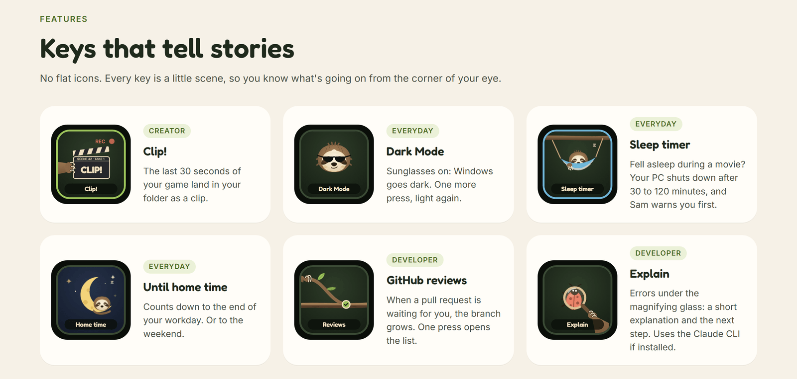
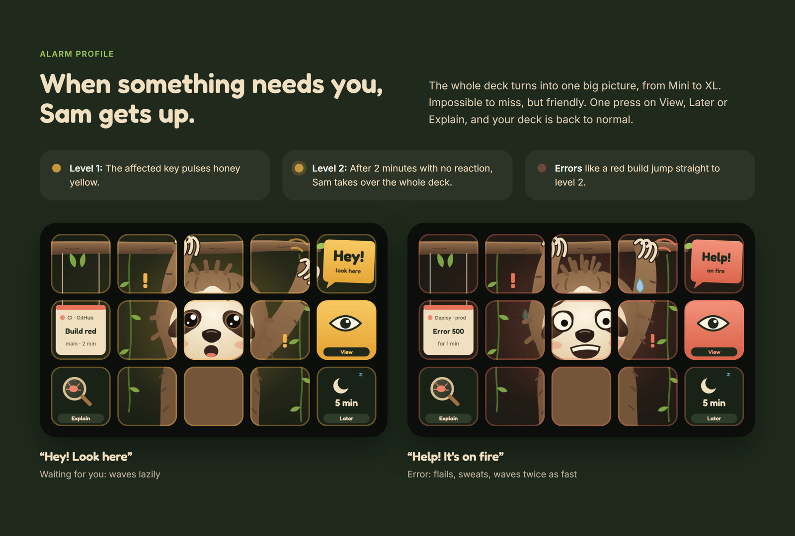
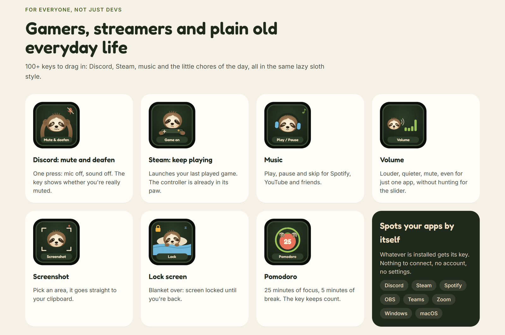
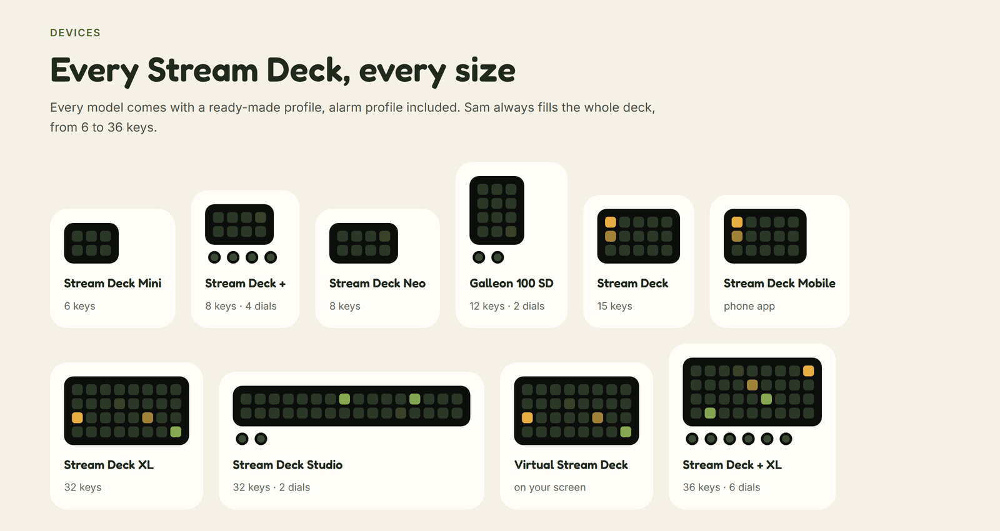

<div align="center">


# Lazy Deck

**The lazy Stream Deck plugin.**
100+ ready-made keys for music, Discord, Steam, timers and everyday stuff, plus **Sam**,
a sloth that sleeps on your deck and takes it over when something needs you.

[**Download the latest release**](../../releases/latest) · [lazy-deck.com](https://lazy-deck.com) · Windows & macOS · free · zero setup

</div>

---

## Keys that tell stories

No flat icons. Every key is a little scene, so you know what's going on from the corner of your eye.



## When something needs you, Sam gets up

A failing build, a waiting review, a finished download: the whole deck turns into one big picture, from Mini to XL.
Impossible to miss, but friendly. One press on **View**, **Later** or **Explain**, and your deck is back to normal.



- **Level 1:** the affected key pulses honey yellow.
- **Level 2:** after 2 minutes without a reaction, Sam takes over the whole deck.
- **Errors** jump straight to level 2.

Any script, CI job or bot on your machine can wake Sam up with a single local call
(in Windows PowerShell write `curl.exe` instead of `curl`):

```bash
curl "http://127.0.0.1:47321/alert?level=error&title=Build%20failed&source=CI"
curl "http://127.0.0.1:47321/alert?title=Review%20waiting&url=https://github.com"   # wait: on the deck after 2 min, now=1 for right away
curl http://127.0.0.1:47321/clear
```

The server only listens on `127.0.0.1`, rejects requests coming from web pages and only opens http and https links.

## For gamers, streamers and plain old everyday life



Every command is its own key: drag it in, done. Only where there's a real choice (which app, which station, how long) does a key have settings.

| Key | What it does |
| --- | --- |
| **Sam** | Sleeps while everything's quiet, wakes up when something needs you. Press it to bring the alarm onto the deck. |
| **Music** | Play/pause, next, previous, louder, quieter, mute. Media keys for Spotify, YouTube and the browser. |
| **Discord** | Mute, deafen or open. Mutes Discord itself in Windows, whatever mic Discord uses; the key shows the real state. |
| **Steam** | Launches your last played game or opens library, friends, Big Picture, store. Reads your local Steam library, no login. |
| **Switch output** | Headphones, speakers, monitor: one press, next device. Virtual devices are skipped. |
| **App volume / app mic** | Volume or mic for just one app: the game in front, Discord, Spotify, Teams, Zoom, browser. Dials on the Stream Deck +. |
| **Brightness** | Brighter or darker, external monitors included (DDC/CI). |
| **Radio** | 15 German stations or your own stream link, nothing to install. |
| **Stay awake / sleep timer** | Keeps your PC awake, or shuts it down in 30–120 minutes; Sam warns you a minute before. |
| **Steam downloads** | Shows the progress; when a big download is done, Sam lets you know. |
| **Pomodoro, timers, home time** | 25 minutes of focus, 5 of break, countdowns to the end of your workday. |
| **Windows & tools** | Snap windows, virtual desktops, dark mode, screenshot, lock, clipboard history, emoji, password generator and more. |

## Every Stream Deck, every size

Every model comes with a ready-made profile, alarm profile included. Sam always fills the whole deck, from 6 to 36 keys.



## Install

1. Download `lazy-deck-<version>.streamDeckPlugin` from the [latest release](../../releases/latest).
2. Double-click it. Stream Deck installs the plugin along with the **Lazy Deck** profile and its alarm profile.
3. Pick the **Lazy Deck** profile and press the alarm test key to meet Sam.

Heads-up: the key names inside Stream Deck are German for now (the website speaks eight languages).

## Build it yourself

You need Node.js 20.5 or newer.

```bash
npm install
npm run pack        # builds dist/com.lazydeck.plugin.streamDeckPlugin
npm test            # alarm logic, server, Steam parser, text fits its key
```

During development you can link the plugin folder straight into Stream Deck (this also works from WSL and restarts Stream Deck):

```bash
npm run build && npm run link     # undo: npm run unlink
```

<div align="center">
<br>
<sub>Made for lazy people, by a lazy person. Sam says hi. 🦥</sub>
</div>
