<div align="center">

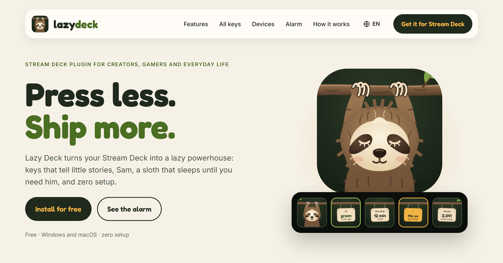

# Lazy Deck

**The lazy Stream Deck plugin.**
100+ ready-made keys for music, Discord, Steam, timers and everyday stuff, plus **Sam**,
a sloth that sleeps on your deck and takes it over when something needs you.

[**Download the latest release**](../../releases/latest) · [lazy-deck.com](https://lazy-deck.com) · Windows & macOS · free · zero setup

</div>

---

## Keys that tell stories

No flat icons. Every key is a little scene, so you know what's going on from the corner of your eye.


## When something needs you, Sam gets up

A failing build, a waiting review, a finished download: the whole deck turns into one big picture, from Mini to XL.
Impossible to miss, but friendly. One press on **View**, **Later** or **Explain**, and your deck is back to normal.


- **Level 1:** the affected key pulses honey yellow.
- **Level 2:** after 2 minutes without a reaction, Sam takes over the whole deck.
- **Errors** jump straight to level 2.

Any script, CI job or bot on your machine can wake Sam up with a single local call
(in Windows PowerShell write `curl.exe` instead of `curl`):

```bash
curl "http://127.0.0.1:47321/alert?level=error&title=Build%20failed&source=CI"
curl "http://127.0.0.1:47321/alert?title=Review%20waiting&url=https://github.com"   # wait: on the deck after 2 min, now=1 for right away
curl http://127.0.0.1:47321/clear
```

The server only listens on `127.0.0.1`, rejects requests coming from web pages and only opens http and https links.

## For gamers, streamers and plain old everyday life


Every command is its own key: drag it in, done. Only where there's a real choice (which app, which station, how long) does a key have settings.

| Key | What it does |
| --- | --- |
| **Sam** | Sleeps while everything's quiet, wakes up when something needs you. Press it to bring the alarm onto the deck. |
| **Music** | Play/pause, next, previous, louder, quieter, mute. Media keys for Spotify, YouTube and the browser. |
| **Discord** | Mute, deafen or open. Mutes Discord itself in Windows, whatever mic Discord uses; the key shows the real state. |
| **Steam** | Launches your last played game or opens library, friends, Big Picture, store. Reads your local Steam library, no login. |
| **Switch output** | Headphones, speakers, monitor: one press, next device. Virtual devices are skipped. |
| **App volume / app mic** | Volume or mic for just one app: the game in front, Discord, Spotify, Teams, Zoom, browser. Dials on the Stream Deck +. |
| **Brightness** | Brighter or darker, external monitors included (DDC/CI). |
| **Radio** | 15 German stations or your own stream link, nothing to install. |
| **Stay awake / sleep timer** | Keeps your PC awake, or shuts it down in 30–120 minutes; Sam warns you a minute before. |
| **Steam downloads** | Shows the progress; when a big download is done, Sam lets you know. |
| **Pomodoro, timers, home time** | 25 minutes of focus, 5 of break, countdowns to the end of your workday. |
| **Windows & tools** | Snap windows, virtual desktops, dark mode, screenshot, lock, clipboard history, emoji, password generator and more. |

<!-- keys:start -->
## All 107 keys

Every command is its own key: drag it in, done. Only where there's a real choice, like which app or how long, does a key have settings.

### Sam & alarm (2)

<table>
<tr><td align="center" valign="top" width="25%">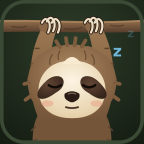<br><b>Sam</b><br><sub>Sleeps while everything's quiet. Wakes up and pulses when something is waiting for you. Press it to bring the alarm onto the whole deck.</sub></td><td align="center" valign="top" width="25%">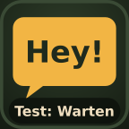<br><b>Test alarm</b><br><sub>Fires a sample alarm so you can see how your deck reacts.</sub></td></tr>
</table>

### Sound & music (18)

<table>
<tr><td align="center" valign="top" width="25%">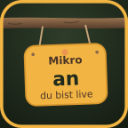<br><b>Microphone</b><br><sub>Mutes your system mic for every app at once: Discord, Teams, Zoom, OBS. The key shows the real state.</sub></td><td align="center" valign="top" width="25%">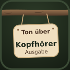<br><b>Switch output</b><br><sub>Switches sound between your devices: headphones, speakers, monitor. Virtual devices (Voicemod, Loopback …) are skipped. Or pick exactly two.</sub></td><td align="center" valign="top" width="25%">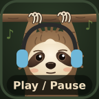<br><b>Play / Pause</b><br><sub>Plays or pauses your music: Spotify, YouTube, browser and most players. When something's playing, Sam has his eyes open.</sub></td><td align="center" valign="top" width="25%">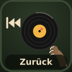<br><b>Previous</b><br><sub>Previous track.</sub></td></tr>
<tr><td align="center" valign="top" width="25%">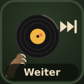<br><b>Next</b><br><sub>Next track.</sub></td><td align="center" valign="top" width="25%">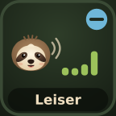<br><b>Volume down</b><br><sub>Turns everything down and shows where the volume is.</sub></td><td align="center" valign="top" width="25%">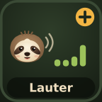<br><b>Volume up</b><br><sub>Turns everything up and shows where the volume is.</sub></td><td align="center" valign="top" width="25%">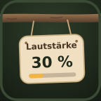<br><b>Volume / Mute</b><br><sub>Shows the volume as a sign on a branch. Press to mute and unmute.</sub></td></tr>
<tr><td align="center" valign="top" width="25%">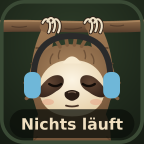<br><b>Now playing</b><br><sub>Shows the cover and title of whatever's playing (Spotify, YouTube, browser …). Press: play/pause.</sub></td><td align="center" valign="top" width="25%">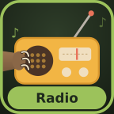<br><b>Radio</b><br><sub>Plays a radio station, one press on, one press off. Nothing to install, no account.</sub></td><td align="center" valign="top" width="25%">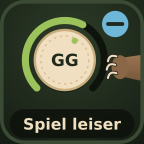<br><b>App volume</b><br><sub>Louder, quieter or muted, just for one app: the game in front, Discord, Spotify, browser … or everything together. On a dial: turn and press.</sub></td><td align="center" valign="top" width="25%">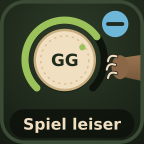<br><b>Game quieter</b><br><sub>Turns down only the game (or the app in front), Discord and music stay the same.</sub></td></tr>
<tr><td align="center" valign="top" width="25%">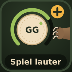<br><b>Game louder</b><br><sub>Turns up only the game (or the app in front).</sub></td><td align="center" valign="top" width="25%">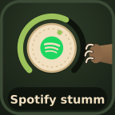<br><b>Mute Spotify</b><br><sub>Mutes and unmutes just Spotify.</sub></td><td align="center" valign="top" width="25%"><br><b>App mic</b><br><sub>Mutes the mic for just one app, e.g. Teams, Zoom or Meet in the browser. Other apps can still hear you. The key shows the real state.</sub></td><td align="center" valign="top" width="25%"><br><b>Teams mic</b><br><sub>Mutes only the mic in Microsoft Teams.</sub></td></tr>
<tr><td align="center" valign="top" width="25%"><br><b>Zoom mic</b><br><sub>Mutes only the mic in Zoom.</sub></td><td align="center" valign="top" width="25%"><br><b>Meet mic (browser)</b><br><sub>Mutes the mic in your browser, e.g. in Google Meet or Jitsi.</sub></td></tr>
</table>

### Discord (3)

<table>
<tr><td align="center" valign="top" width="25%"><br><b>Discord mic</b><br><sub>Mutes only Discord, no matter which mic is picked there. The key shows the real state.</sub></td><td align="center" valign="top" width="25%"><br><b>Discord deafen</b><br><sub>Discord hears and sends nothing: sound and mic off together.</sub></td><td align="center" valign="top" width="25%"><br><b>Open Discord</b><br><sub>Opens Discord.</sub></td></tr>
</table>

### Steam & gaming (10)

<table>
<tr><td align="center" valign="top" width="25%">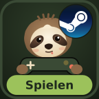<br><b>Last played</b><br><sub>Launches the Steam game you played last.</sub></td><td align="center" valign="top" width="25%">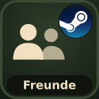<br><b>Steam friends</b><br><sub>Opens your friends list in Steam.</sub></td><td align="center" valign="top" width="25%">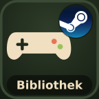<br><b>Steam library</b><br><sub>Opens your Steam library.</sub></td><td align="center" valign="top" width="25%"><br><b>Steam Big Picture</b><br><sub>Starts Steam in Big Picture mode, for TVs and controllers.</sub></td></tr>
<tr><td align="center" valign="top" width="25%"><br><b>Steam store</b><br><sub>Opens the Steam store.</sub></td><td align="center" valign="top" width="25%">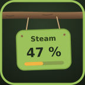<br><b>Steam downloads</b><br><sub>How far along Steam's downloads are. When a big download finishes, Sam lets you know, even without this key.</sub></td><td align="center" valign="top" width="25%"><br><b>Save last 30 s</b><br><sub>Save the last 30 s with the Windows Xbox Game Bar.</sub></td><td align="center" valign="top" width="25%">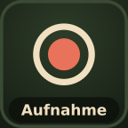<br><b>Recording on/off</b><br><sub>Recording on/off with the Windows Xbox Game Bar.</sub></td></tr>
<tr><td align="center" valign="top" width="25%">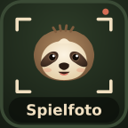<br><b>Game screenshot</b><br><sub>Game screenshot with the Windows Xbox Game Bar.</sub></td><td align="center" valign="top" width="25%">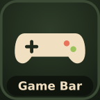<br><b>Open Game Bar</b><br><sub>Opens the Windows Xbox Game Bar.</sub></td></tr>
</table>

### Screen & windows (11)

<table>
<tr><td align="center" valign="top" width="25%">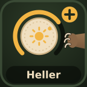<br><b>Brightness</b><br><sub>Screen brighter or darker, external monitors too (via DDC/CI, like Twinkle Tray). On a dial: turn.</sub></td><td align="center" valign="top" width="25%">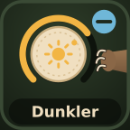<br><b>Darker</b><br><sub>All screens darker, external monitors too.</sub></td><td align="center" valign="top" width="25%"><br><b>Brighter</b><br><sub>All screens brighter, external monitors too.</sub></td><td align="center" valign="top" width="25%">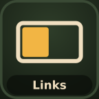<br><b>Snap left</b><br><sub>Snap the window left.</sub></td></tr>
<tr><td align="center" valign="top" width="25%">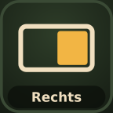<br><b>Snap right</b><br><sub>Snap the window right.</sub></td><td align="center" valign="top" width="25%">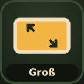<br><b>Maximize</b><br><sub>Maximize the window.</sub></td><td align="center" valign="top" width="25%">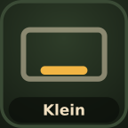<br><b>Minimize</b><br><sub>Minimize the window.</sub></td><td align="center" valign="top" width="25%">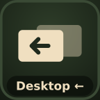<br><b>Virtual desktop left</b></td></tr>
<tr><td align="center" valign="top" width="25%">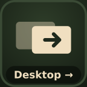<br><b>Virtual desktop right</b></td><td align="center" valign="top" width="25%">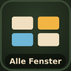<br><b>Task view</b></td><td align="center" valign="top" width="25%">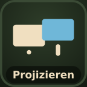<br><b>Project (2nd screen)</b><br><sub>Project to a 2nd screen.</sub></td></tr>
</table>

### Windows (10)

<table>
<tr><td align="center" valign="top" width="25%">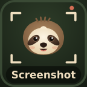<br><b>Screenshot (area)</b><br><sub>Screenshot of an area.</sub></td><td align="center" valign="top" width="25%">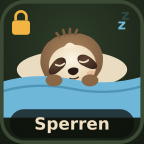<br><b>Lock screen</b><br><sub>Lock the screen.</sub></td><td align="center" valign="top" width="25%">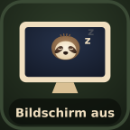<br><b>Screen off</b><br><sub>Turn the screen off.</sub></td><td align="center" valign="top" width="25%">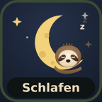<br><b>Sleep</b><br><sub>Put the PC to sleep. Press twice, just to be safe.</sub></td></tr>
<tr><td align="center" valign="top" width="25%"><br><b>Toggle dark mode</b></td><td align="center" valign="top" width="25%">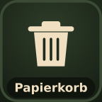<br><b>Empty Recycle Bin</b><br><sub>Empty the Recycle Bin. Press twice, just to be safe.</sub></td><td align="center" valign="top" width="25%">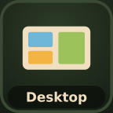<br><b>Show desktop</b><br><sub>Show the desktop.</sub></td><td align="center" valign="top" width="25%">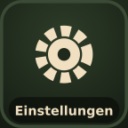<br><b>Settings</b><br><sub>Open Settings.</sub></td></tr>
<tr><td align="center" valign="top" width="25%">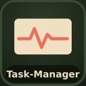<br><b>Task Manager</b><br><sub>Open Task Manager.</sub></td><td align="center" valign="top" width="25%">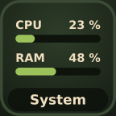<br><b>System</b><br><sub>CPU and memory. Press to open Task Manager.</sub></td></tr>
</table>

### Time & reminders (10)

<table>
<tr><td align="center" valign="top" width="25%"><br><b>Stay awake</b><br><sub>Your PC and screen won't fall asleep while the key is on: for downloads, presentations, movies.</sub></td><td align="center" valign="top" width="25%">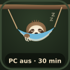<br><b>Shutdown timer</b><br><sub>PC off or asleep in 30, 60 or 90 minutes, e.g. during a movie at night. Press again: 30 more minutes, hold: cancel. Sam gives you a heads-up a minute before.</sub></td><td align="center" valign="top" width="25%">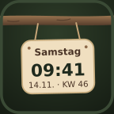<br><b>Clock</b><br><sub>Time, weekday, date and week number.</sub></td><td align="center" valign="top" width="25%">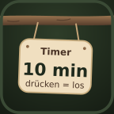<br><b>Timer</b><br><sub>Kitchen timer: press to start/pause, hold to reset. When it runs out, Sam lets you know.</sub></td></tr>
<tr><td align="center" valign="top" width="25%">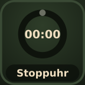<br><b>Stopwatch</b><br><sub>Press to start/stop, hold to reset.</sub></td><td align="center" valign="top" width="25%">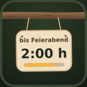<br><b>Until end of day</b><br><sub>How long until the end of your workday (5 pm, adjustable).</sub></td><td align="center" valign="top" width="25%">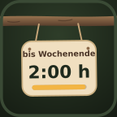<br><b>Until weekend</b><br><sub>How long until Friday's end of work.</sub></td><td align="center" valign="top" width="25%">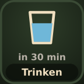<br><b>Drink water</b><br><sub>Reminds you to drink every hour. Press to mark it done.</sub></td></tr>
<tr><td align="center" valign="top" width="25%"><br><b>Move</b><br><sub>Reminds you to move every 45 minutes. Press to mark it done.</sub></td><td align="center" valign="top" width="25%"><br><b>Pomodoro</b><br><sub>25 minutes of focus, 5 minutes of break. Press: start/pause, hold: reset. Sam lets you know when time's up.</sub></td></tr>
</table>

### Weather & status (4)

<table>
<tr><td align="center" valign="top" width="25%"><br><b>Weather</b><br><sub>Weather for where you are, no setup. Your location comes from your IP address (ipwho.is), the weather from Open-Meteo.</sub></td><td align="center" valign="top" width="25%"><br><b>Internet</b><br><sub>Shows how fast your internet responds. If it's gone for 30 seconds, Sam lets you know.</sub></td><td align="center" valign="top" width="25%"><br><b>Wi-Fi</b><br><sub>Wi-Fi name and signal strength.</sub></td><td align="center" valign="top" width="25%"><br><b>Battery</b><br><sub>Battery level and whether it's charging (laptops). On a desktop: mains power.</sub></td></tr>
</table>

### Apps, sites & folders (29)

<table>
<tr><td align="center" valign="top" width="25%"><br><b>Launch Spotify</b><br><sub>Launches Spotify with one press.</sub></td><td align="center" valign="top" width="25%"><br><b>Launch Discord</b><br><sub>Launches Discord with one press.</sub></td><td align="center" valign="top" width="25%"><br><b>Launch Steam</b><br><sub>Launches Steam with one press.</sub></td><td align="center" valign="top" width="25%"><br><b>Launch WhatsApp</b><br><sub>Launches WhatsApp with one press.</sub></td></tr>
<tr><td align="center" valign="top" width="25%"><br><b>Launch Microsoft Teams</b><br><sub>Launches Microsoft Teams with one press.</sub></td><td align="center" valign="top" width="25%"><br><b>Launch OBS Studio</b><br><sub>Launches OBS Studio with one press.</sub></td><td align="center" valign="top" width="25%"><br><b>Launch Explorer</b><br><sub>Launches File Explorer with one press.</sub></td><td align="center" valign="top" width="25%"><br><b>Launch Terminal</b><br><sub>Launches Terminal with one press.</sub></td></tr>
<tr><td align="center" valign="top" width="25%"><br><b>Launch Notepad</b><br><sub>Launches Notepad with one press.</sub></td><td align="center" valign="top" width="25%"><br><b>Open YouTube</b><br><sub>Opens YouTube in your browser.</sub></td><td align="center" valign="top" width="25%"><br><b>Open Netflix</b><br><sub>Opens Netflix in your browser.</sub></td><td align="center" valign="top" width="25%"><br><b>Open Twitch</b><br><sub>Opens Twitch in your browser.</sub></td></tr>
<tr><td align="center" valign="top" width="25%"><br><b>Open Gmail</b><br><sub>Opens Gmail in your browser.</sub></td><td align="center" valign="top" width="25%"><br><b>Open WhatsApp Web</b><br><sub>Opens WhatsApp Web in your browser.</sub></td><td align="center" valign="top" width="25%"><br><b>Open Prime Video</b><br><sub>Opens Prime Video in your browser.</sub></td><td align="center" valign="top" width="25%"><br><b>Open Disney+</b><br><sub>Opens Disney+ in your browser.</sub></td></tr>
<tr><td align="center" valign="top" width="25%"><br><b>Open Claude</b><br><sub>Opens Claude in your browser.</sub></td><td align="center" valign="top" width="25%"><br><b>Open Google Maps</b><br><sub>Opens Google Maps in your browser.</sub></td><td align="center" valign="top" width="25%"><br><b>Open DeepL Translator</b><br><sub>Opens DeepL Translator in your browser.</sub></td><td align="center" valign="top" width="25%"><br><b>Open ChatGPT</b><br><sub>Opens ChatGPT in your browser.</sub></td></tr>
<tr><td align="center" valign="top" width="25%"><br><b>Open Gemini</b><br><sub>Opens Gemini in your browser.</sub></td><td align="center" valign="top" width="25%"><br><b>Open Grok</b><br><sub>Opens Grok in your browser.</sub></td><td align="center" valign="top" width="25%"><br><b>Downloads folder</b><br><sub>Opens your Downloads folder.</sub></td><td align="center" valign="top" width="25%"><br><b>Documents folder</b><br><sub>Opens your Documents folder.</sub></td></tr>
<tr><td align="center" valign="top" width="25%"><br><b>Pictures folder</b><br><sub>Opens your Pictures folder.</sub></td><td align="center" valign="top" width="25%"><br><b>Desktop folder</b><br><sub>Opens your Desktop folder.</sub></td><td align="center" valign="top" width="25%"><br><b>Music folder</b><br><sub>Opens your Music folder.</sub></td><td align="center" valign="top" width="25%"><br><b>Videos folder</b><br><sub>Opens your Videos folder.</sub></td></tr>
<tr><td align="center" valign="top" width="25%"><br><b>User folder</b><br><sub>Opens your user folder.</sub></td></tr>
</table>

### Tools (10)

<table>
<tr><td align="center" valign="top" width="25%"><br><b>Clipboard history</b></td><td align="center" valign="top" width="25%"><br><b>Emoji picker</b></td><td align="center" valign="top" width="25%"><br><b>Windows notifications</b><br><sub>Windows notification center.</sub></td><td align="center" valign="top" width="25%"><br><b>Calculator</b></td></tr>
<tr><td align="center" valign="top" width="25%"><br><b>Paste today's date</b><br><sub>Pastes today's date.</sub></td><td align="center" valign="top" width="25%"><br><b>Generate password</b><br><sub>Generates a password and copies it to the clipboard.</sub></td><td align="center" valign="top" width="25%"><br><b>Coin flip</b><br><sub>Heads or tails. Heads shows Sam.</sub></td><td align="center" valign="top" width="25%"><br><b>Dice</b><br><sub>Rolls a number from 1 to 6.</sub></td></tr>
<tr><td align="center" valign="top" width="25%"><br><b>GitHub notifications</b><br><sub>Unread GitHub notifications. Uses the gh-CLI you're signed in with.</sub></td><td align="center" valign="top" width="25%"><br><b>GitHub reviews</b><br><sub>Reviews waiting for you. New ones trigger an alarm.</sub></td></tr>
</table>
<!-- keys:end -->

## Every Stream Deck, every size

Every model comes with a ready-made profile, alarm profile included. Sam always fills the whole deck, from 6 to 36 keys. On the Stream Deck Neo, Sam also lives in the info bar: the time, the focus timer, or the alert that is waiting for you.


## Install

1. Download `lazy-deck-<version>.streamDeckPlugin` from the [latest release](../../releases/latest).
2. Double-click it. Stream Deck installs the plugin along with the **Lazy Deck** profile and its alarm profile. Requires Stream Deck 7.6 or newer.
3. Pick the **Lazy Deck** profile and press the alarm test key to meet Sam.

Heads-up: the key names inside Stream Deck are German for now (the website speaks eight languages).

## Build it yourself

You need Node.js 20.5 or newer.

```bash
npm install
npm run pack        # builds dist/com.lazydeck.plugin.streamDeckPlugin
npm test            # alarm logic, server, Steam parser, text fits its key
```

During development you can link the plugin folder straight into Stream Deck (this also works from WSL and restarts Stream Deck):

```bash
npm run build && npm run link     # undo: npm run unlink
```

## License

[MIT](LICENSE). Do what you like with it, just keep the copyright notice.

<div align="center">
<br>
<sub>Made for lazy people, by a lazy person. Sam says hi. 🦥</sub>
</div>
